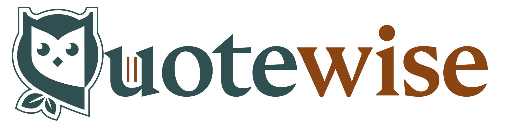

<p align="center">
  <picture>
    <source media="(prefers-color-scheme: dark)" srcset="./quotewise-logo-dark-mode.svg">
    
  </picture>
</p>

<h3 align="center">Find quotes by meaning. See the sources before you share.</h3>

LLMs and web search invent quotes and sources. [Quotewise](https://quotewise.io/) is semantic quote search that shows its evidence. Describe a feeling ("courage during setbacks") and get quotes that capture it, even in different words. For each quote, **QuoteSightings** lists every place we found it (books, URLs, Wikiquote), so you can check the evidence and decide for yourself.

## Start here: MCP in 30 seconds

Add Quotewise to your AI tool. No signup. Anonymous use is limited to 20 requests/day.

```bash
# Claude Code
claude mcp add --transport http quotewise https://mcp.quotewise.io/

# Guided setup for other clients
npx @quotewise/mcp setup
```

Remote server: `https://mcp.quotewise.io/`. It works with Claude Code, Claude Desktop, ChatGPT (dev mode), Codex CLI, Gemini CLI and Cursor.

Then ask: *"Find me quotes about courage during setbacks, with sources."* Or: *"Did Einstein really say that?"*

| Tool | What it does |
|---|---|
| `quotes_about` | Semantic search by idea or feeling |
| `quotes_by` | Quotes from a given person |
| `who_said` | Checks attribution and flags misattributions |
| `quotes_like` | Finds quotes similar to one you have |
| `cite_quote` | Produces a citation |
| `collection`, `collection_quotes` | Work with your saved collections (API key required) |

## Repositories

| Repo | What it is |
|---|---|
| [**mcp**](https://github.com/quotewise/mcp) | The Quotewise MCP server, for quote search and attribution checks inside your AI tools. |
| [**skills**](https://github.com/quotewise/skills) | Portable Agent Skill: any client that loads `SKILL.md` can use it. It calls the same MCP server, or the CLI when MCP isn't connected. Includes a Claude Code / Cowork plugin adapter. |
| [**quotewise-browser-extension**](https://github.com/quotewise/quotewise-browser-extension) | Quote Capture for Chrome and Firefox (MV3). Capture a quote from one post on X, Threads, Bluesky or Substack Notes, with author, source link and a duplicate check. Curators review new contributors' submissions. It only reads the single post you choose. Firefox: on addons.mozilla.org. Chrome: not yet in the Web Store, so build from source. |

## How we think about attribution

Every attribution is a provisional judgment backed by typed, inspectable evidence: earliest known appearance, primary source, corroboration, refutation, documented absence. It is recorded in an append-only audit trail. The approach draws on quotation scholarship, source criticism and textual criticism. Fabricated citations in academic papers rose sixfold between 2023 and 2025, so we think showing the evidence matters.

Read the [methodology](https://quotewise.io/about/methodology/).

## Links

[Website](https://quotewise.io/) · [Developers: API and MCP docs](https://quotewise.io/developers/) · [Methodology](https://quotewise.io/about/methodology/) · [Trust Center](https://quotewise.io/about/trust/) · [What we collect](https://quotewise.io/about/what-to-collect/) · [FAQ](https://quotewise.io/about/faq/) · [Extensions](https://quotewise.io/extensions/) · [X @quotewiseio](https://x.com/quotewiseio)
